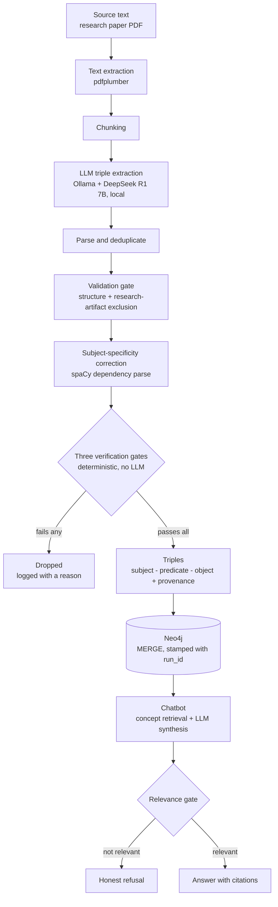
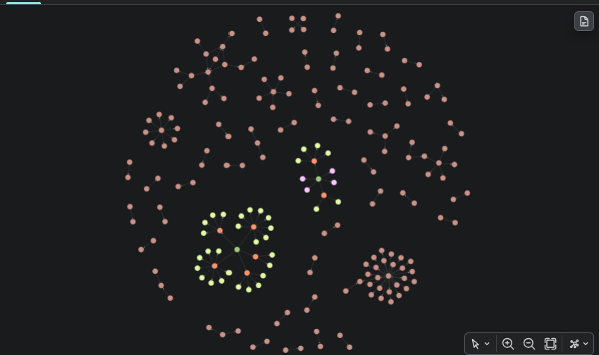
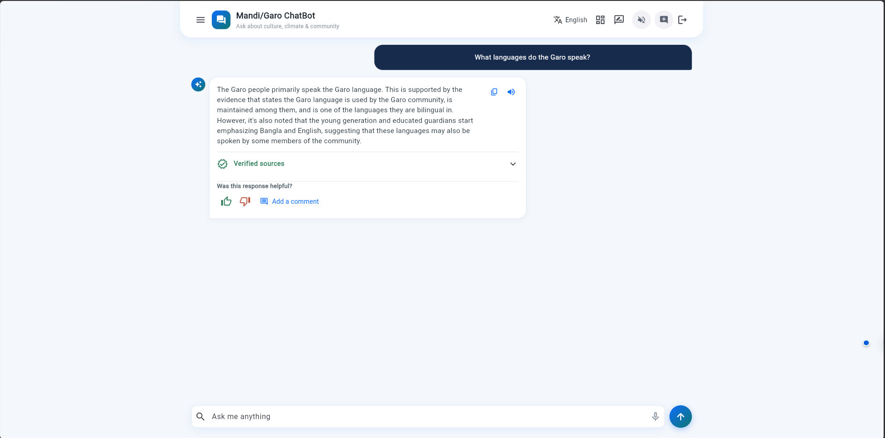

# Climate Knowledge Graph — Extraction Pipeline and Chatbot

A pipeline that reads research papers, asks a locally-hosted LLM to turn prose into
subject–predicate–object triples, drops every triple it cannot prove is quoted from the
source, loads the survivors into Neo4j, and answers questions from the resulting graph.

This is a portfolio version of a university capstone project (EAT40005, Swinburne
University of Technology, 2026). It began as a six-person team project; see
[My contribution and team credits](#my-contribution-and-team-credits) for who did what.

**This repository is not runnable as published.** It has no source corpus, no language
model and no database. That is deliberate — see [What is not here](#what-is-not-here). It
is here to be read.

---

## Overview

The problem: a body of published research contains facts about a community's climate
adaptation, livelihoods and traditional practices, and a chatbot should be able to answer
questions from it without making anything up.

The approach: extract triples with an LLM, then refuse to trust the LLM. Everything after
extraction is deterministic. Three gates check each candidate triple:

1. **Well-formedness** — is this a sentence-shaped fact, not a fragment or a tautology?
2. **Grounding** — does it carry a citation, and is that citation a sentence rather than a
   whole paragraph?
3. **Quote genuineness** — does the cited sentence appear *verbatim* on the page of the PDF
   it claims to come from?

A triple that fails any gate is dropped, not queued for review. The graph feeds a chatbot
with no human in the loop, so a wrong fact reaches a user directly while a missing one only
means the chatbot knows less.

The measured consequence of that choice: **578 extracted candidates became 45 stored
triples** across three papers, and the hallucination rate went from 1.00 to 0.00. The
[Evaluation](#evaluation) section has the full trade-off, including what it cost.

### What is not here

| Excluded | Why |
|---|---|
| The source corpus (62 PDFs) | Published academic research literature about the Garo/Mandi community of Bangladesh. Third-party copyright, and republishing a collected corpus is not mine to do |
| Every extracted triple, and the graph CSVs | A deliberate choice not to redistribute aggregated community knowledge as a reusable dataset |
| The manual ground-truth workbook | Holds 128 sentences transcribed verbatim from the papers |
| The Flutter frontend, authentication, translation, text-to-speech, admin dashboard | My teammates' work. Credited below, not copied |
| Deployment and hosting configuration | Live infrastructure for a system being handed over to the client |

Credentials, database identifiers, host addresses and email addresses have been replaced
with placeholders throughout.

---

## How this was built

I used Claude Code as the primary development tool for my work on this project, and the
repository records how rather than just that.

**134 of my 163 commits carry a Claude co-author trailer** — 82% — across four model
versions (Opus 5: 77, Sonnet 5: 49, Opus 5.5: 9, Haiku 4.5: 8).

The workflow was design spec → implementation plan → tests → code → measure, and the
artefacts survive: four design documents totalling 3,312 lines, all written by me. Two ship
in [`docs/design/`](docs/design/); the other two are described in
[`docs/design/README.md`](docs/design/README.md).

What is worth looking at is not the volume but the loop — the evidence repeatedly overturned
the design:

- **A fabricated citation reached a live user.** Asked how the Garo trace lineage, the
  chatbot answered *"as stated in Pütz (1991) who identified family as one of the domains of
  study"* — welding together two facts that shared only the word "family". I wrote a design
  spec, then a plan, then a gate that makes the model emit `RELEVANT: yes|no` as its first
  line and **discards everything after a "no" in code**, rather than trusting the model to
  stop writing. Two earlier prompt-only attempts had failed; that is what motivated moving
  the control out of the prompt and into code.
- **I built an LLM verification pass and then deleted it.** Commit `e4dc3da`: *"Make the LLM
  verify pass opt-in, not default — deterministic gates alone already hit 0% hallucination."*
  It cost 8+ hours of CPU time per paper and showed no measurable benefit over the
  deterministic gates, so it went.
- **I re-ran every prompt four times before trusting any prompt result.** That is what
  exposed the nondeterminism in [Evaluation](#evaluation), and it is why the prompt
  comparison reports ranges rather than single figures.

[`PROCESS.md`](PROCESS.md) has the detail.

---

## Architecture



No LLM call happens between extraction and the database. The gates, the subject correction
and the loader are all deterministic and cost about a second per few hundred rows.

Every stored relationship carries `source_file`, `page_number`, `paper_title`,
`sentence_ref`, `passage` and `confidence`, plus a `run_id` and `ingested_at` — so any
triple in the graph traces back to the sentence it came from, and any load can be identified
or rolled back afterwards.

---

## How it was run

These are the commands I actually used. They will not work in this repository as published,
because it has no corpus, no model and no database.

```bash
# containers: the app plus a local Ollama, with a named volume for the model
docker compose up -d
docker compose exec app ollama pull deepseek-r1:7b

# full pipeline on one paper: extract, gate, load
docker compose exec app python main.py papers/<paper>.pdf

# everything except the database write
docker compose exec app python main.py papers/<paper>.pdf --dry-run

# gates alone, against an existing extraction CSV
python run_verification_pipeline.py output/<paper>_kg.csv \
    --wellformedness-check --grounding-check --quote-check --pdf papers/<paper>.pdf

# score an extraction against the manual ground truth
python -m eval.run_eval --csv output/<paper>_kg_refined.csv --label "my run"

# the chatbot, interactively
python rag.py --approach concept
```

To run this yourself you would need: a PDF corpus of your own; Ollama with `deepseek-r1:7b`
(~4.7GB); a Neo4j instance; and a `.env` built from [`.env.example`](.env.example).

### What I verified in this repository

The unit tests run and pass here. Nothing else does.

```
$ NEO4J_URI=neo4j+s://xxxxxxxx.databases.neo4j.io python -m pytest -q
176 passed in 1.63s
```

A placeholder `NEO4J_URI` is needed because `neo4j_loader/connection.py` constructs its
driver at import time — itself a design flaw, noted in [`LIMITATIONS.md`](LIMITATIONS.md).

Seven test files from the original repository are **not** included: six import `rag.py`,
which has top-level imports on modules excluded from this copy, and one reads the excluded
ground-truth workbook. I removed them rather than ship a suite that errors on collection.

---

## Evaluation

Two separate experiments. Both are reported in full, including the parts that look bad.

### 1. Prompt comparison — 17 extraction runs

Four prompt configurations against a human-annotated page with 23 manually extracted triples
as ground truth. Each configuration was run four times, because the first round's results did
not survive a re-run.

| Configuration | Runs | Triples extracted | True positives (strict) | Avg precision | Avg recall | Avg F1 (strict) | Avg F1 (lenient) |
|---|---|---|---|---|---|---|---|
| Baseline (PR007) | 5 | 31–38 | 2–11 | 0.112 | 0.165 | 0.133 | 0.477 |
| Variant A — most-specific subject | 4 | 27–39 | 2–8 | 0.156 | 0.217 | 0.180 | 0.438 |
| Variant B — single consistent predicate | 4 | 35–52 | 0–2 | 0.023 | 0.043 | 0.030 | 0.468 |
| Variant C — A and B combined | 4 | 23–43 | 1–13 | **0.215** | **0.315** | **0.251** | 0.452 |

*Strict = exact semantic match. Lenient = exact plus near-match.*

**The most useful finding was that the pipeline is nondeterministic.** True positives per run,
in order:

| Configuration | Run 1 | Run 2 | Run 3 | Run 4 |
|---|---|---|---|---|
| Baseline | 11 | 2 | 2 | 2 |
| Variant A | 6 | 2 | 4 | 8 |
| Variant B | 1 | 0 | 1 | 2 |
| Variant C | 8 | 7 | 13 | **1** |

Variant C's best run scored 13 and its worst scored 1, on identical input, with `temperature`
at 0.1. Had I stopped after one round I would have concluded Variant C was a clear winner and
the baseline a disaster. Four rounds say Variant C is *probably* better, and that a single
prompt measurement on this pipeline means very little. Variant B is the one unambiguous
result: constraining the predicate made duplication **worse**, reproducibly.

### 2. The verification gates — 13 scored configurations

Scored against a 7-page paper with 136 ground-truth facts. Selected rows:

| Configuration | Precision | Recall | F1 | Hallucination rate | Citation coverage | Triples/page |
|---|---|---|---|---|---|---|
| A: live prompt (page 3) | 0.000 | 0.000 | 0.000 | **1.000** | 0.000 | 35.0 |
| B: strict tacit-only (page 3) | 0.080 | 0.087 | 0.083 | **1.000** | 0.960 | 25.0 |
| C: broad-v2 + LLM verify (page 3) | 0.500 | 0.174 | 0.258 | 0.000 | 1.000 | 8.0 |
| C-hardened (page 3) | 1.000 | 0.087 | 0.160 | 0.000 | 1.000 | 2.0 |
| C-hardened, full corpus | 0.111 | 0.015 | 0.026 | 0.833 | 1.000 | 2.57 |
| C-hardened + grounding, full corpus | 0.667 | 0.015 | 0.029 | 0.000 | 1.000 | 0.43 |
| **+ tautology check, full corpus** | **1.000** | **0.015** | **0.029** | **0.000** | **1.000** | **0.29** |

The final row is the configuration that shipped. Read honestly, it says:

- **Hallucination went from 1.00 to 0.00.** Every stored triple is verbatim-traceable to a
  sentence on a page.
- **It kept 2 triples out of 136 ground-truth facts** — a recall of 1.5%.

That is a deliberate trade, not an accident, and for this system it is the right one: the
chatbot has no human review step, so precision is the property that matters. But a 1.5%
recall is a severe limitation and the next section treats it as one. An F1 of 0.029 is not a
good score; it is an honest one.

---

## Where it fails

Full detail, with measurements, in [`LIMITATIONS.md`](LIMITATIONS.md). The headlines:

- **Recall is 1.5%.** The gates work by dropping almost everything. Most of the useful
  content in a paper never reaches the graph.
- **The graph is a star, not a graph.** Of 67 entities across 45 triples, 59 appear exactly
  once. `MERGE` matches on the name string alone, so `GaroCommunity` and `Garo_People`
  became two separate nodes for the same people. There is almost nothing to traverse, which
  defeats much of the point of using a graph database.
- **The predicate vocabulary is unbounded.** 32 predicates for 45 triples, 26 used exactly
  once. Five describe language use and none match each other.
- **Triples are lost quietly in places.** The loader I inherited discarded
  `UNKNOWN`-subject triples and printed a flat success message. Separately, one PDF with a
  damaged text layer lost 79% of its candidates to the quote gate, with no signal
  distinguishing "bad PDF" from "bad prompt".
- **The synthesizer invents connections between real facts.** Partly fixed by the relevance
  gate, but it is all-or-nothing: mostly-good evidence plus one irrelevant triple still gets
  synthesized.
- **The relevance gate over-refuses.** It declined "What is the Garo population?" while the
  triple that answers it sat first in its own evidence list.
- **End-to-end automation yields almost nothing.** One real run: 98 raw triples in 73
  minutes, 1 survived the gates — and that survivor was wrong.

### What I would do differently

1. **Entity resolution before anything else.** It is the root cause of the star shape, and
   two other defects turned out to be it surfacing downstream rather than independent bugs.
   It gets harder with every paper added.
2. **A controlled predicate vocabulary**, applied at load time in
   `neo4j_loader/cleaner.py` so it does not require re-extracting every paper.
3. **Per-triple relevance classification** instead of the all-or-nothing gate.
4. **Fix recall by improving extraction, not by loosening the gates.** The gates are not the
   problem; the candidates they reject are mostly genuinely broken.
5. **Report ranges, never single runs, for anything LLM-generated.** This one I learned the
   hard way and would now do from the start.

---

## My contribution and team credits

This began as a six-person university group project. My teammates built the Flutter
frontend, the authentication and account system, multilingual answers and text-to-speech,
the admin dashboard, and the community-data processing modules. **None of that is in this
repository.** I have not reproduced their work, and where their code is needed for mine to
make sense it is named below.

### Mine

| Area | Evidence |
|---|---|
| **Verification gates** — well-formedness, grounding, quote genuineness; designed, shrunk from five gates to three, wired into the production path as a hard gate | `verification/` — 14 commits, sole author |
| **Evaluation harness** — precision/recall/F1 strict and lenient, hallucination rate separated from ground-truth comparison, citation coverage | `eval/` — 12 commits, sole author |
| **Prompt versioning and the comparison matrix** — 17 logged runs, 4 configurations × 4 rounds | `prompts/` — sole author; `test_extraction_prompt_config.py` |
| **Subject-specificity correction** — spaCy dependency parse, to stop every fact collapsing onto one hub subject | `subject_specificity.py` — sole author |
| **Retrieval comparison harness** | `tools/compare_retrieval_paths.py` — sole author |
| **Docker containerisation** | `Dockerfile`, `docker-compose.yml`, `.dockerignore` — sole author (`1574f0f`); `3aff5fa` fixed the `OLLAMA_URL` service-name bug that containerising exposed |
| **Credentials moved out of code into `.env`** — `config.py` reading from the environment, `.env.example`, `.env` gitignored; later a code-level guard making "LLM inference stays local" a property of the code rather than of a config file | `1574f0f`, `a77f683` |
| **Onboarding README** — the team's Docker quick start | 14 of 25 README commits, including every structural one |
| **Extraction prompt fixes** — enforced triple syntax so the parser stopped collapsing output to `UNKNOWN`; excluded methodology content; prevented comma-collapsed objects | `7cd1a3e`, `d7ddf67` |
| **Loader fixes** — see below | `1574f0f`, `652b23a`, `71ab41f`, `d74d36f` |

**The loader**, in more detail, because it is the clearest before-and-after. The version I
inherited was:

```python
def add_triples(triples):
    with driver.session() as session:
        for triple in triples:
            if triple["subject"] != "UNKNOWN":
                session.execute_write(insert_triple, triple)
    print("Triples uploaded to Neo4j.")
```

Triples were discarded silently and the operator was told it had worked. It now returns
`(inserted, skipped, run_id)`, reports the skipped count, carries `source_file` provenance,
stamps every relationship with a `run_id` and `ingested_at`, and supports rolling back a
load by that run id without sweeping orphans it did not create.

### Shared code in this repository

`rag.py` (3,382 lines) is the team's chatbot and HTTP API, kept whole because trimming it
would misrepresent what the system actually was. My work inside it:

| What | Where | Commits |
|---|---|---|
| Rarity-weighted retrieval scoring (IDF over the graph, not just field matching) | `score_triple_weighted` — line 203 | `fbcb9af` |
| Ranking on the question's own words rather than a fixed keyword list the graph never matched | `ConceptRetriever` — line 510 | `b95afd8` |
| Morphological matching, and stopping `"live"` false-matching `"livelihood"` | `_keyword_matches` line 162, `_keyword_in_triple` line 170 | `bdf8e61`, `5cb610f` |
| Topic filter, shared by the graph and CSV retrieval paths | `topic_focused` — line 234 | `10705e6` |
| Synthesis prompt evidence cap and timeout; surfacing Ollama errors instead of swallowing them | `AnswerSynthesizer` — line 1619 | `e2b0472`, `9f85a66`, `609a949` |
| Relevance gate — discards post-`RELEVANT: no` prose in code | line 2095, and `docs/design/` | see `docs/design/` |

Other shared files included for completeness, with their principal authors noted:
`neo4j_loader/` (mine, with contributions from three teammates), `source_provenance.py` (a
teammate's; imported by the loader), `confidence_framework.py` (mine, with contributions
from three teammates — and documented as unstable in `LIMITATIONS.md`).

Commit hashes refer to the original team repository.

---

## Screenshots



**The production database, visualised.** Mostly two-node fragments and isolated
single-appearance entities, with a handful of small hubs — the star-not-a-graph defect from
[`LIMITATIONS.md`](LIMITATIONS.md) item 3, visible as shape. The denser green and purple
clusters are the application's own conversation and feedback nodes, not extracted knowledge.
Cropped to the canvas; the surrounding console showed live database identifiers.



**The chatbot answering from the graph.** A live, uncached query. The answer separates what
the evidence states from what it merely suggests — *"suggesting that these languages may also
be spoken"* — rather than flattening both into assertion. The "Verified sources" panel
beneath it expands to the triples and page citations the answer was built from.


**The admin dashboard**, built by a teammate. Included because it shows where this pipeline
sits in the finished product: paper admission scores and approves a source document, which
triggers extraction, and feedback review lets an admin archive triples that produced a bad
answer. The chatbot is one tile among several.

Capture notes: [`docs/screenshots/README.md`](docs/screenshots/README.md).

---

## Licence and provenance

University coursework, republished for portfolio purposes. See [`NOTICE.md`](NOTICE.md):
contributors retain copyright in their own contributions, and this is not licensed for reuse.
